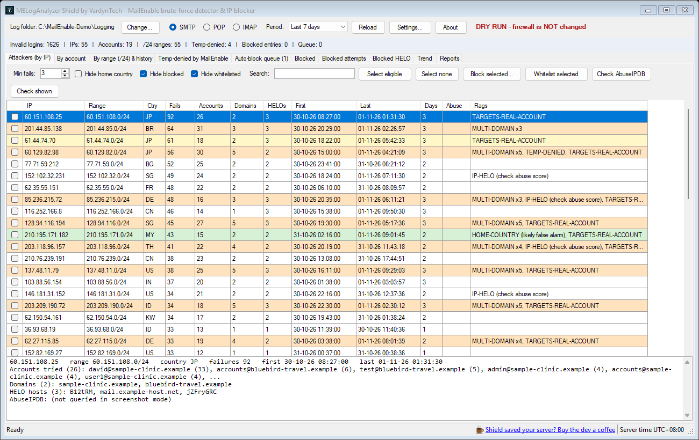
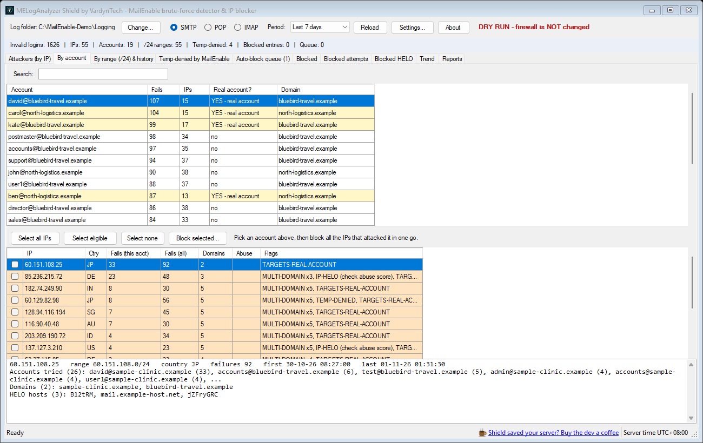
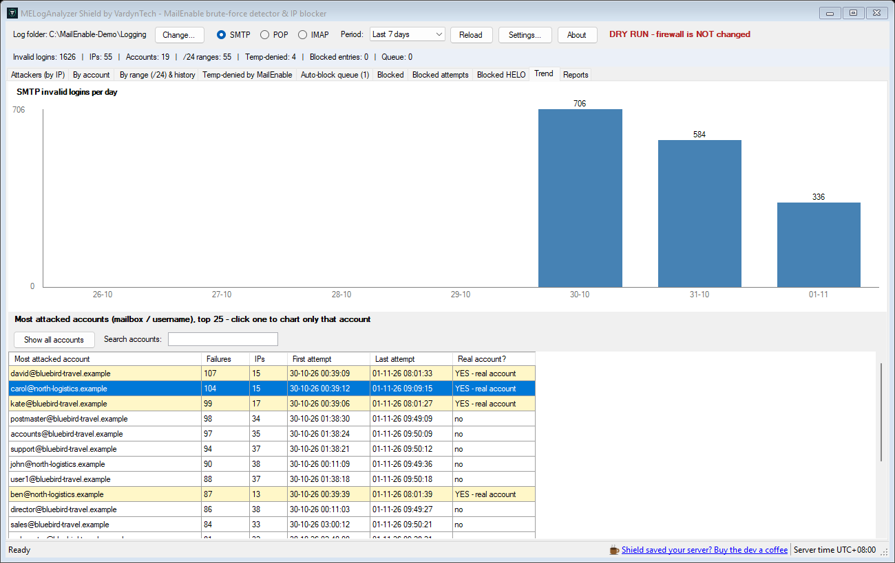
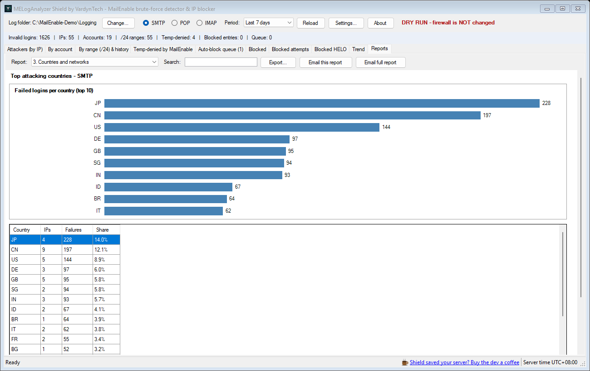

# MELogAnalyzer Shield by VardynTech

**Stop brute-force attacks on your MailEnable server.**
Shield reads your MailEnable SMTP, POP and IMAP logs, finds who is guessing passwords or hammering unknown accounts, and blocks them in Windows Firewall - automatically, or only after you approve.

Free for everyone running MailEnable. No licence key, no install, no cloud account, no telemetry.

[Download the latest release](https://github.com/VardynTech/MELogAnalyzer-Shield/releases/latest) · [Buy the dev a coffee](https://buymeacoffee.com/vardyntech) · [vardyntech.com](https://vardyntech.com)

---

## What it does

- **Finds the attackers.** Failed logins per IP, with the accounts and domains each IP tried, the HELO names it used, its country, and flags such as `MULTI-DOMAIN`, `RANDOM-HELO`, `TEMP-DENIED`, `HAS-GOOD-LOGINS`.
- **Blocks them in Windows Firewall.** Single IPs or whole /24 ranges, in inbound block rules it creates and manages itself. A dry run is on by default, so nothing is changed until you turn it off.
- **Protects real users.** Home-country addresses, IPs that also logged in successfully, whitelisted IPs, your private ranges and this server's own addresses are never auto-blocked.
- **Auto-block, your way.** Off, ask-first (a review queue) or fully automatic. Separate limits for SMTP, POP and IMAP if you want them, and you can switch protection off per service.
- **Catches slow attackers.** A reputation rule blocks an IP whose AbuseIPDB score is high even when its failures are hours apart.
- **Keeps working when you log off.** One button installs a background task (every 5 minutes) that applies your auto-block rules.
- **Shows that blocks work.** The Blocked tab shows whether a blocked address still reached MailEnable, and how many attempts Windows Firewall dropped (needs the firewall's drop log, which Shield can switch on for you).
- **Reports.** Compromised-account hints, most targeted domains and accounts, countries and networks, daily summary, block effectiveness and repeat offenders. Export to HTML or CSV, or email the report on a schedule.

## Tabs

| Tab | What it is for |
|---|---|
| Attackers (by IP) | Every IP with failed logins, details, AbuseIPDB score, block / whitelist |
| By account | Pick a targeted account, see and block every IP that attacked it |
| By range (/24) & history | Ranges that keep coming back day after day |
| Temp-denied by MailEnable | IPs MailEnable itself already refused |
| Auto-block queue | Proposals waiting for your OK |
| Blocked | What is blocked, why and when; unblock, unblock + whitelist, export |
| Blocked attempts | Connection attempts Windows Firewall dropped from blocked addresses |
| Blocked HELO | The HELO names used by blocked IPs, to spot what they have in common |
| Log search | Find any text (a HELO name, account, domain, IP) in the raw log lines, flagged or not; block IPs from the results, export |
| Trend | Failed logins per hour or per day, per account |
| Reports | Six ready-made reports with charts, export and email |

## Quick start

1. Download the zip from the [Releases page](https://github.com/VardynTech/MELogAnalyzer-Shield/releases/latest) and unzip it on the mail server (a permanent folder, not Downloads or Temp).
2. Run `MELogAnalyzer-Shield-by-VardynTech.exe` and accept the administrator prompt (needed to change firewall rules).
3. Pick the MailEnable **Logging** folder, the one that contains `SMTP`, `POP` and `IMAP`.
4. Choose a service and a period. The first load of a large folder takes a while; finished days are cached.
5. Leave **DRY RUN** on until you are happy with what it would block, then turn it off in Settings.
6. Optional: add your free [AbuseIPDB](https://www.abuseipdb.com/register) API key for reputation scores, set up the email report, and click **Run in background** to keep protecting the server after you log off.

## Requirements

- Windows Server 2008 / Vista or later for firewall rules (on older Windows it still reads logs and exports lists, but cannot add rules). Tested on Windows Server 2008 R2 and 2012, including blocking, the background task and email reports.
- .NET Framework 4.0 or later, which is built into Windows Server 2008 R2 and later.
- Read access to the MailEnable log folder, and administrator rights for blocking.
- IPv4 only.
- Internet access is optional. It is used only for AbuseIPDB lookups and reports, and the email report, when you turn them on.

## Privacy

- Everything runs on your server. Logs are read locally and never uploaded.
- There is no telemetry and no phone-home.
- AbuseIPDB lookups send only an IP address. Reporting to AbuseIPDB is **off by default**; when you turn it on it sends the IP, category 18 (brute force), a general comment and the time of the last attempt. Never account names, domains, mailboxes, counts or mail content.
- Your AbuseIPDB key and email password are stored encrypted for this machine.

## Safety notes

- Dry run is on by default.
- Every action (block, unblock, export, report) is written to an action log, with a "Remove ALL rules" panic button.
- Shield adds only block rules of its own (default name prefix `Vardyn-MEBlock`) and never touches your other firewall rules.
- Review the home-country, whitelist and "successful logins" protections in Settings before switching to Automatic.

## Support

Questions, bugs, ideas: open an [issue](https://github.com/VardynTech/MELogAnalyzer-Shield/issues). Please attach the exact message and, if you can, a screenshot with addresses and account names hidden.

If Shield saved your server some pain, [buy the dev a coffee](https://buymeacoffee.com/vardyntech).

## Licence and trademarks

Free to use, including on commercial servers. See [LICENSE.txt](LICENSE.txt). The program is provided as is, without warranty.

MailEnable, Windows, AbuseIPDB and all other product names are trademarks or copyrights of their respective companies. This program is independent and is not made or endorsed by them.

(c) 2026 VardynTech. All rights reserved.

